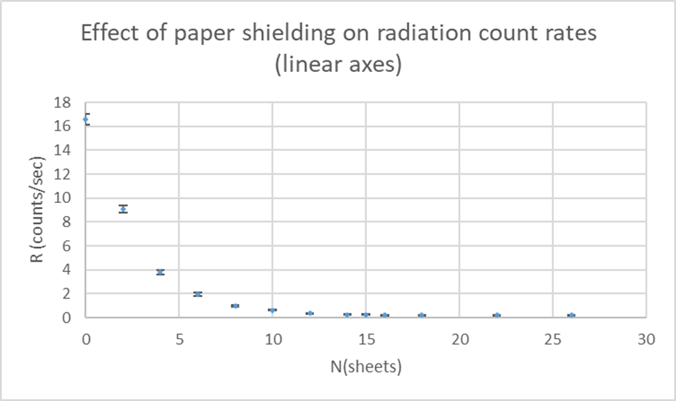
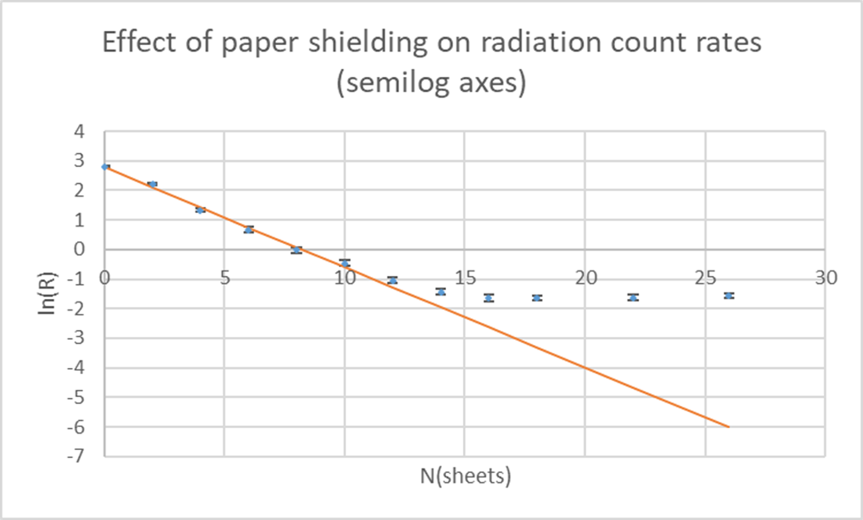

# PHYS 229 Oral Exams: Example Questions (2025W2)

This document provides some examples of the types of questions you can expect during the oral exams.

### Context for the example questions: The PHYS 119 experiment where we are trying to determine how effective paper is at blocking radiation from an Iron-55 source

A reasonable model for the count-rate of the radiation emitted from the Iron-55 source and detected by the detector is

$$
R(x) = R_0\,e^{-\mu x} + R_b,
$$

where $$R(x)$$ is the measured count-rate (number of particles detected by the Geiger-Muller detector per unit time) as a function of the number of pieces of paper, $$x$$, blocking the source from the detector. $$R_0$$ is the count rate with no paper shielding, $$\mu$$ is the attenuation coefficient and $$R_b$$ is the background radiation count-rate.

The two graphs below show some data plotted on linear-linear and semi-log axes, with the semi-log graph showing a simple linear fit to only the first 6 data points.

 

### Example questions

#### Background physics

1. Why is paper an appropriate choice of shielding for an Iron-55 source?
2. How does a Geiger-Muller counter work?
    - Follow-up: What are some of the limitations of this kind of radiation counter? What sort of experimental decision could you make to avoid these limitations?
3. What do each of the parameters $$R_0$$, $$\mu$$ and $$R_b$$ represent physically?
4. Using your fitted value of $$\mu$$, approximately how many sheets of paper does it take to cut the count rate in half? How would you calculate this?
5. If you performed a similar experiment with a different thickness of paper and found that 10 pieces of paper cut the count rate down from 100 counts/s to 10 counts/s, how many pieces of paper would be required to cut the count rate down from 100 counts/s to 1 count/s?

#### Visualizations, Model and Fitting

{: start="6"}
6. Justify your choices for your x- and y-axis variables
    - Follow-up: When performing your fits, did you include or ignore your x-axis uncertainties in your fit? Why was this a reasonable choice?
7. What quantity is represented by the slope of the simple linear fit to the first 6 data points on the second graph?
    - Follow-up: If there was no background radiation present in this experiment, would you expect this slope to go up, down or remain the same?
8. On the linear plot, you can visually see the count rate approaching a roughly constant value at large N. On the semi-log plot, the same data flattens out. Are these two features showing you the same thing or different things?
9. If there were no background radiation ($$R_b = 0$$), what would the semi-log plot look like?
10. Let's say you performed a nonlinear fit using the model $$R(x) = R_0 e^{-\mu x} + R_b$$ for the first graph and $$\ln(R(x)) = \ln(R_0 e^{-\mu x} + R_b)$$ for the second graph. Would these two representations give the same value for the fitting parameters? Why or why not?
11. Let's look at each of the fitting parameters: $$R_0$$, $$\mu$$ and $$R_b$$. For each, if you want to increase your confidence that you are doing a good job of determining that fitting parameter, describe for which values of N it would be best to concentrate your data collection.
12. Looking at the semi-log plot, the data points at high values of N flatten out rather than continuing to decrease. Why?
    - Follow-up: If you wanted to verify that this flattening is due to background radiation and not some other effect, how could you design a measurement to test this?
13. Your group decides to fit the data to $$R(x) = R_0 e^{-\mu x} + R_b$$, and allow $$R_b$$ to be a free parameter in your fit. Your neighbours decide to measure $$R_b$$ directly and subtract this count-rate from their measured count-rates to give themselves corrected count-rates, $$R'(x)$$. They then fit to $$R'(x) = R_0 e^{-\mu x}$$. Discuss the advantages and disadvantages of each of these approaches.
    - Follow-up: If your direct measurement of $$R_b$$ had a systematic that resulted in it being slightly underestimated, how would this change your chi-squared value and your residuals?
14. Imagine that two of your paper sheets were stuck together and you didn't notice, so every measurement of N(sheets) > 0 should actually have been one sheet more than what you recorded. Which of your three fitting parameters would be most affected, and which would be least affected?

#### Assumptions

{: start="15"}
15. Were there any quantities or effects in this experiment that you decided were negligible? For each of these, what would be the impact on your experimental results if these quantities weren't negligible?
16. Which quantities have you assumed are constant but might actually vary as you take your measurements?

#### Uncertainties

{: start="17"}
17. Describe how you determined your uncertainty in your count rate, R. Justify your choice of uncertainty for each of the quantities involved.
18. At which values of N(sheets), low or high, does your data have lower relative uncertainty?
19. Imagine you set up the experiment with 20 sheets of paper and count for 10 seconds, getting 4 counts. Then you count again for 10 seconds and get 9 counts. These seem very different. Should you be worried?
20. What is your dominant source of random/measurement uncertainty? What steps did you take to minimize this uncertainty?
21. You and the group sitting across from you both determine a value for $$\mu$$ from your fits. You get $$\mu = 0.30 \pm 0.02$$ per sheet and they get $$\mu = 0.36 \pm 0.03$$ per sheet. Are these results consistent with each other? How would you decide?
22. What is your dominant systematic effect or uncertainty? How have you tried to account for it?
    - Follow-up: If you were able to completely eliminate this systematic effect, how would it impact your final result for your target quantity (increase it, decrease it, make the uncertainty go down,...?)

#### Experimental Design and Decisions

{: start="23"}
23. Why did we choose to vary the number of sheets of paper rather than, say, varying the distance between the source and detector?
24. If you could only collect data at 5 values of N(sheets), instead of the full range shown, which 5 would you choose and why?
25. What if your detector had a slow drift in performance after it was powered on, making its detection efficiency gradually increase over time. How would this affect the shape of your data or your fitting parameters?
    - Follow-up: How could you modify your data collection procedure to check for or eliminate this kind of systematic effect?
26. If you were going to run this experiment a second time with the goal of getting a more precise value of $$\mu$$, what is the single most impactful change you would make?

